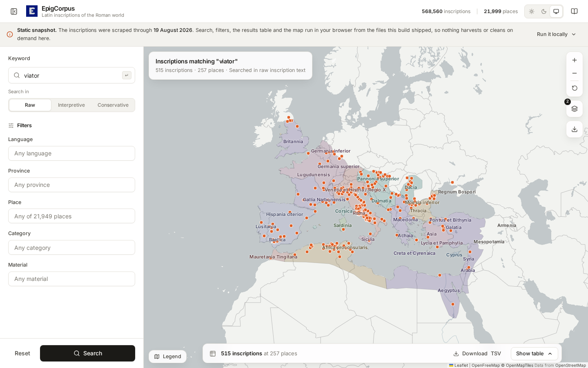
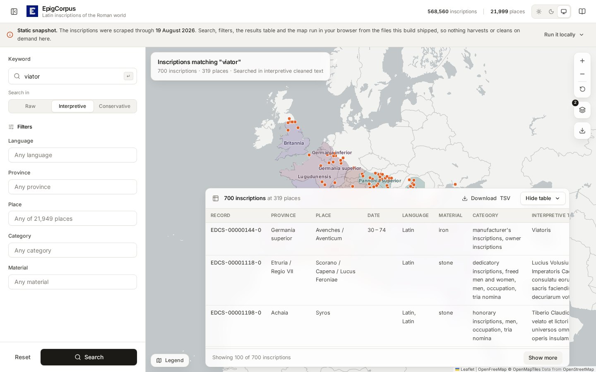
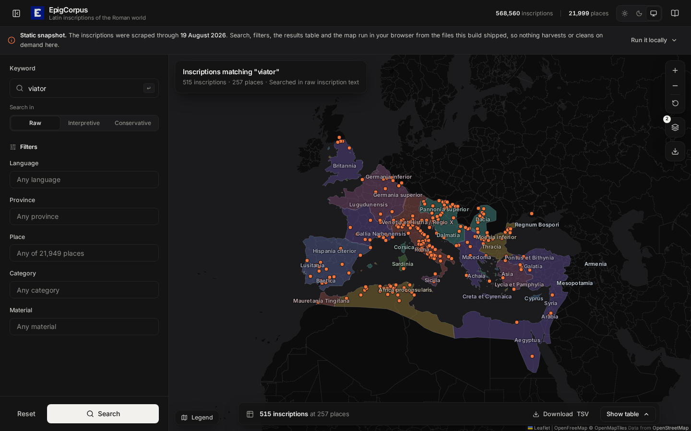
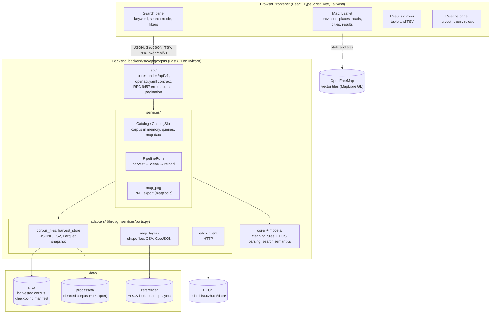
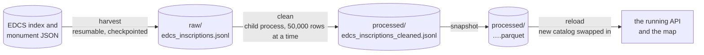

<p align="center">
  
</p>

<h1 align="center">EpigCorpus</h1>

<p align="center">A reproducible Latin epigraphy pipeline for extracting, cleaning, and exploring EDCS inscriptions.</p>

<p align="center">
  <a href="https://epigcorpus.sanoj.dev"><strong>Open the live map →</strong></a>
  &nbsp;·&nbsp; <a href="#quick-start">Run it locally</a>
  &nbsp;·&nbsp; <a href="#how-to-cite">Cite it</a>
  &nbsp;·&nbsp; <a href="#data-and-software-references">Sources</a>
</p>

<p align="center">
  <a href="LICENSE"></a>
  <a href="https://github.com/d-sanoj/EpigCorpus/actions/workflows/ci.yml"></a>
  <a href="https://epigcorpus.sanoj.dev"></a>
  <a href="CITATION.cff"></a>
  
  
  
</p>

<p align="center">
  <a href="https://epigcorpus.sanoj.dev/?q=viator&search_in=raw">
    
  </a>
  <br />
  <sub>The live site, searching the raw EDCS text for <em>viator</em>: 515 inscriptions at 257 places.</sub>
</p>

---

EpigCorpus is a reproducible Latin epigraphy pipeline for extracting inscriptions from the Epigraphik-Datenbank Clauss / Slaby (EDCS), cleaning inscription text into research-ready variants, and exploring results on an interactive Roman Empire map.

The repository is designed as a practical, end-to-end workflow:
1. Scrape EDCS data incrementally with checkpoint resume.
2. Generate conservative and interpretive cleaned text.
3. Explore and export results through an HTTP API and the web map built on it.

## Contents

- [Why EpigCorpus](#why-epigcorpus)
- [The corpus at a glance](#the-corpus-at-a-glance)
- [Highlights](#highlights)
- [Try it in the browser](#try-it-in-the-browser)
- [Quick start](#quick-start)
- [Using the API](#using-the-api)
- [Conservative and interpretive text](#conservative-and-interpretive-text)
- [Data products](#data-products)
- [Architecture](#architecture) and [pipeline details](#pipeline-details)
- [Repository layout](#repository-layout)
- [Development](#development)
- [Host it without a server](#host-it-without-a-server)
- [Research](#research)
- [Reproducibility notes](#reproducibility-notes)
- [Contributing](#contributing)
- [How to cite](#how-to-cite)
- [Data and Software References](#data-and-software-references)
- [License](#license)

## Why EpigCorpus

The EDCS is a central reference for Latin inscriptions, but
working with it at scale — counting a formula across provinces, comparing a
term's distribution, or training a model — needs the whole corpus as a table,
in a known state, with the editorial markup handled consistently.

EpigCorpus provides that:

- **The whole corpus as data.** One row per inscription, with province,
  place, coordinates, dating, language, material, categories, the
  publication reference and the EDCS source URL, committed to the repository
  as compressed JSONL and TSV.
- **Text you can analyse.** Each inscription keeps the raw EDCS text with its
  editorial markup and gains two cleaned readings: *conservative* (close to
  what is carved) and *interpretive* (the editors' reading).
- **A map to think with.** Search any of the three texts, filter by language,
  province, place, category and material, and see the result on the Roman
  provinces, roads and cities, then download the table or a publication-style
  map.
- **Reproducible by design.** The harvest is resumable and recorded in a
  manifest; cleaning is deterministic; the snapshot's EDCS release and dates
  are written down (see [Reproducibility notes](#reproducibility-notes)).

It is meant for epigraphers, Roman historians, classicists and
digital-humanities researchers and students, whether they want a quick
distribution map in the browser or a clean corpus to load into pandas or R.

EpigCorpus follows and measures itself against the LatEpig tool of
Ballsun-Stanton, Hermankova and Laurence (see
[Upstream Method Reference](#upstream-method-reference)). EDCS later withdrew
the `/api/query` endpoint LatEpig used ([docs/LATEPIG_BREAKAGE.md](docs/LATEPIG_BREAKAGE.md),
[docs/EDCS_API.md](docs/EDCS_API.md)), and the harvest here reads EDCS's
static data endpoints instead. The two cleaning pipelines are compared rule by
rule in [docs/CLEANING_COMPARISON.md](docs/CLEANING_COMPARISON.md).

## The corpus at a glance

The snapshot committed in `data/` (see `data/raw/harvest/edcs_harvest_manifest.json`):

| | |
|---|---|
| EDCS release | `20260807-142626` |
| Harvested | 2026-08-19, 0 failed fetches |
| Monuments | 542,854 |
| Inscription rows | 588,509 |
| Searchable on the map (coordinates within the Roman world) | 568,560 inscriptions |
| Distinct places in the place filter | 21,949 |
| Provinces / languages / categories / materials in the filters | 62 / 14 / 37 / 21 |

The EDCS is the source of every inscription; EpigCorpus is a derived,
cleaned copy of it, not a replacement. Check readings against the EDCS record
(each row carries its `source_url`) and the publication it cites.

## Author

- Sanoj Doddapaneni

## Software Citation

Doddapaneni, S. (n.d.). EpigCorpus: A reproducible Latin epigraphy pipeline for extracting, cleaning, and exploring EDCS inscriptions [Computer software]. GitHub.

Machine-readable metadata is in [CITATION.cff](CITATION.cff); GitHub's
"Cite this repository" button reads it. See also [How to cite](#how-to-cite).

## Highlights

- Incremental scraping against the current EDCS API with append-only updates.
- One-row-per-inscription data model.
- Structured exports in JSONL and TSV.
- Two cleaning outputs for analysis workflows:
  - Conservative Cleaned Inscriptions
  - Interpretive Cleaned Inscriptions
- Interactive map in a light and a dark theme, on OpenFreeMap vector
  basemaps (Positron and Dark Matter designs, no API key), with their place
  names removed. When zoomed out, known places are grouped into a density
  grid; zoomed in, there is one solid circle per place, sized by its
  inscription count. Stacked bottom to top: basemap, Roman provinces with
  their names (the base, on by default), teal known places, roads, ochre
  cities, and terracotta search results on top.
- Search across raw and cleaned text, with filters for language, province,
  place, category and material.
- TSV download of the results and a publication-style 4K PNG map export
  (3,840 × 2,798) that follows the query's filters and the map's layers.
- An in-app data pipeline: harvest from the EDCS, clean, and reload the
  corpus into the running server.
- A versioned HTTP API (`/api/v1`, OpenAPI 3.1) for search, records, cleaned
  variants, places (also as GeoJSON), downloads, lookups and pipeline runs.

## Try it in the browser

**[epigcorpus.sanoj.dev](https://epigcorpus.sanoj.dev)** runs the map with
nothing to install. It is a static snapshot: the corpus is precomputed into
the site's files and every query — filters, keyword, per-place counts,
paging — is answered in your browser. The page states the date its data goes
up to. The harvest-and-clean pipeline and the server's 4K PNG are only in a
local run (see [docs/static-site.md](docs/static-site.md) for exactly what
differs).

Every search is kept in the address bar, so a view can be shared or cited as
a link, for example
[`?q=viator&search_in=interpretive`](https://epigcorpus.sanoj.dev/?q=viator&search_in=interpretive).

<table>
  <tr>
    <td width="50%"></td>
    <td width="50%"></td>
  </tr>
  <tr>
    <td><sub>The results table: record, province, place, date, language, material, categories and the searched text, with a TSV download.</sub></td>
    <td><sub>The dark theme.</sub></td>
  </tr>
</table>

### Example PNG Export (term: viator)


## Quick start

With Docker (nothing else to install):

```bash
git clone https://github.com/d-sanoj/EpigCorpus.git
cd EpigCorpus
docker compose up --build        # http://localhost:8000
```

Or locally, with [uv](https://docs.astral.sh/uv/) and Node 22:

```bash
cd frontend && npm ci && npm run build && cd ..          # the web UI, once
cd backend && uv sync
uv run uvicorn epigcorpus.api.server:app --port 8000     # http://127.0.0.1:8000
```

The server answers from the cleaned corpus committed in `data/`. The first
start converts it to a Parquet snapshot, which takes about a minute. After
that it starts in a few seconds. `GET /api/v1/health` reports
`"ready": true` once the corpus is loaded.

To harvest from the EDCS, clean, and load the new corpus, use the
**Pipeline** panel in the web UI, or the API:

```bash
curl -X POST localhost:8000/api/v1/pipeline-runs -H 'content-type: application/json' -d '{}'
```

A full pipeline run peaks at about 3 GB of memory (see `docker-compose.yml`).

## Using the API

The running server documents itself: the contract is
[`backend/src/epigcorpus/api/openapi.yaml`](backend/src/epigcorpus/api/openapi.yaml)
(OpenAPI 3.1). A few requests against the committed corpus:

```bash
# Keyword search; search_in is raw, interpretive or conservative
curl 'localhost:8000/api/v1/inscriptions/search?q=viator&search_in=raw&limit=1'
# -> 515 matches; the first is EDCS-00000144-0, Avenches / Aventicum, "Viator(is)?"

# Filters only: Latin inscriptions from Noricum
curl 'localhost:8000/api/v1/inscriptions?province=Noricum&language=Latin&limit=10'

# One inscription, every column (publication, dating, source_url, ...)
curl 'localhost:8000/api/v1/inscriptions/EDCS-00000144-0'

# A query's results as TSV, and the map as a 4K PNG
curl -o viator.tsv 'localhost:8000/api/v1/exports/search.tsv?q=viator'
curl -o viator.png 'localhost:8000/api/v1/exports/map.png?q=viator&resolution=4k'

# The filter values present in the corpus
curl 'localhost:8000/api/v1/facets'
```

Results are paged with a cursor (`page.next_cursor`); errors follow RFC 9457.
Note that the TSV export selects whole **monuments**, so every inscription on
a matching monument is included.

To work with the data directly, the corpus files load with pandas as they are:

```python
import pandas as pd

df = pd.read_json("data/processed/edcs_inscriptions_cleaned.jsonl.gz", lines=True)
```

## Conservative and interpretive text

Each inscription has three texts:

| Column | What it is |
|---|---|
| `inscription_text` | The EDCS text, markup intact |
| `inscription_text_conservative` | Approximates what is carved on the stone: editorial expansions are dropped, and where the editors corrected the text the *inscribed* letters are kept |
| `inscription_text_interpretive` | The editors' reading: expansions are kept, and where the text was corrected the *corrected* letters are kept |

For example, record `EDCS-00000001-0` (Noricum, Maribor / Marburg):

```text
raw           ?] C(aius) Trebonius IIvir et praef(ectus) i(ure) d(icundo) civitatis Agunti [?
conservative  C Trebonius II vir et praef i d civitatis Agunti
interpretive  Caius Trebonius II vir et praefectus iure dicundo civitatis Agunti
```

The rules (27 conservative, 25 interpretive, applied in order) live in
`backend/src/epigcorpus/core/cleaning.py`, whose docstring lists the markup
handled and the known limitations. The comparison with LatEpig's rules, and
where the two disagree, is in
[docs/CLEANING_COMPARISON.md](docs/CLEANING_COMPARISON.md).

## Data Products

Under `data/` (paths are defined in `backend/src/epigcorpus/config/paths.py`):

- `raw/edcs_inscriptions.jsonl[.gz]`, `raw/edcs_inscriptions.tsv[.gz]`: the
  harvested corpus, one inscription per row.
- `raw/harvest/`: the harvest's checkpoint, manifest and failure list.
- `reference/edcs_lookup.json`: the EDCS code tables; `reference/map_layers/`:
  the vendored map layers.
- `processed/edcs_inscriptions_cleaned.jsonl[.gz]`: the cleaned corpus, which
  the API serves. Its Parquet snapshot
  (`processed/edcs_inscriptions_cleaned.parquet`) is rebuilt automatically
  and not committed.

See data/README.md for schemas.

## Architecture

One backend package serves a versioned HTTP API and the built web UI on one
origin. The browser draws the basemap straight from OpenFreeMap; everything
else comes from the API. Inside the backend, dependencies point one way:
routes call services, and services reach files and the network only through
the interfaces in `services/ports.py`, which the adapters implement.



A pipeline run, started from the Pipeline panel (`POST /api/v1/pipeline-runs`):



## Pipeline Details

A pipeline run (`POST /api/v1/pipeline-runs`) has three stages:

1. **Harvest**: `services/scrape.py`, over `adapters/edcs_client.py`.
   It is incremental and resumable from a checkpoint. A cancelled run resumes
   where it stopped.
2. **Clean**: `core/cleaning.py` holds the rules and `services/cleaning.py`
   applies them. Each inscription gets a conservative and an interpretive
   variant.
3. **Reload**: the running server loads the new cleaned corpus and swaps it
   in without a restart.

The web UI is a client of the API:

- Search modes: Raw inscriptions, Interpretive Cleaned Inscriptions,
  Conservative Cleaned Inscriptions.
- Filters for language, province, place, category and material, combinable
  with the keyword.
- A Leaflet map with a layers menu, tooltips and result popups; the legend
  starts collapsed.
- A results drawer, collapsed to one bar until opened, with the table a page
  at a time and the TSV download.
- A 4K PNG export of the map, following the query and the layers switched on.
- Light and dark themes (or the system's), remembered per browser.
- The search is kept in the address bar, so it can be shared as a link.

## Repository Layout

```text
EpigCorpus/
├── backend/               # the epigcorpus Python package (uv project)
│   ├── src/epigcorpus/
│   │   ├── config/        # paths (overridable by environment) and settings
│   │   ├── models/        # the inscription column schema
│   │   ├── core/          # pure rules: cleaning, EDCS parsing, search semantics
│   │   ├── adapters/      # EDCS HTTP client, corpus and harvest files, map layers
│   │   ├── services/      # use cases: harvest, clean, catalog, pipeline runs (+ ports.py)
│   │   └── api/           # FastAPI under /api/v1 and its contract, openapi.yaml
│   └── tests/
├── frontend/              # React + TypeScript + Vite + Tailwind + Leaflet
│   ├── src/api/           # typed client; schema.d.ts is generated from openapi.yaml
│   ├── src/features/      # search panel, map, results drawer, pipeline panel
│   └── e2e/               # Playwright tests against the running app
├── data/                  # raw/, processed/, reference/ (see data/README.md)
├── research/              # the abbreviation study: scripts/, reports/, results/
├── docs/                  # ADRs, API and data notes, refactor records
├── Dockerfile, docker-compose.yml
└── .github/workflows/ci.yml
```

Dependencies point one way. The web UI calls the API, and the API calls
services. Services reach adapters only through the interfaces in
`services/ports.py`; `backend/tests/test_layering.py` enforces this. See
`docs/adr/0001-layered-app-layout.md` and
`docs/adr/0005-backend-frontend-split.md`.


## Development

```bash
# backend
cd backend
uv run pytest                        # unit, contract and layering tests
uv run ruff check src tests

# frontend: Vite on :5173, forwarding /api to the backend on :8000
cd frontend
npm run dev
npm test                             # vitest
npm run typecheck
npm run gen:api                      # regenerate API types after editing openapi.yaml
npm run e2e                          # Playwright, against a server on :8000 (E2E_BASE_URL)
```

Research scripts import the package:
`uv run --project backend python research/scripts/<name>.py`.

CI (`.github/workflows/ci.yml`) runs the backend tests and Ruff, the frontend
type check, unit tests and build, a check that the generated API types match
the contract, Playwright end-to-end tests against the real app on the
committed corpus, and a Docker build.

## Host it without a server

The live site is the same UI built in static mode: the corpus is precomputed
into the site's own files at build time and every query is answered in the
browser; the pipeline is left out, because there is nothing to harvest on. A
clone keeps it: the API-served app is unchanged. The page says so itself, in a
notice under the top bar: the date its data goes up to, and the commands that
run a clone locally.

`.github/workflows/deploy.yml` builds it on every push to `main` and
publishes it to Cloudflare Pages at epigcorpus.sanoj.dev (a fork needs its own
`CLOUDFLARE_API_TOKEN` secret and Pages project). To build it yourself:

```bash
cd backend
uv run python -m epigcorpus.export.static_site --out ../frontend/public/data
cd ../frontend
VITE_DATA_MODE=static VITE_BASE=/ npm run build      # frontend/dist is the whole site
```

See [docs/static-site.md](docs/static-site.md) for the artifacts and what the
static build does differently.

## Research

`research/` holds an abbreviation study built on the corpus: the phase
scripts, their reports and decision log (`research/reports/decisions.md`),
and their results. It is a paper's evidence, not application code; see
[research/README.md](research/README.md). The model dependencies are in the
backend's optional `ml` dependency group.

## Reproducibility Notes

- Scraping is incremental and resumable.
- Cleaning is deterministic for a given input dataset.
- Map search and PNG export use the same cleaned source data.
- The cleaned corpus is written chunk by chunk and verified byte-identical to
  whole-frame cleaning (see CHANGELOG.md for the checksums).
- Map layers and the land outlines are vendored in `data/reference/map_layers`
  with their licences (see its README); only the basemap tiles are fetched at
  run time.
- Search mode naming is synchronized across UI, match summaries, and exports.

The design decisions are recorded as ADRs in [docs/adr/](docs/adr/), and every
change that alters what the corpus *is* is recorded in
[CHANGELOG.md](CHANGELOG.md).

## Contributing

Corrections and contributions are welcome, especially from epigraphers:

- **A cleaning rule gives a wrong reading.** Open an issue with the EDCS
  record ID (`EDCS-…`), the raw text, the output you got and the one you
  expected. Check the known limitations in `core/cleaning.py` and
  [docs/CLEANING_COMPARISON.md](docs/CLEANING_COMPARISON.md) first.
- **A reading itself is wrong.** That comes from the EDCS; please report it to
  the EDCS editors, since EpigCorpus copies their text.
- **Code.** Fork, branch, and open a pull request. Run the checks in
  [Development](#development) first; CI runs the same ones. Changes to the
  cleaning rules should come with a test and a CHANGELOG entry.

## How to cite

If you use EpigCorpus in your research, please cite the software and, above
all, the EDCS, from which every inscription comes. Cite also the other
sources you rely on, such as the AWMC layers in a map or LatEpig for the
method, from [Data and Software References](#data-and-software-references).

The software citation is given under [Software Citation](#software-citation),
and [CITATION.cff](CITATION.cff) holds the same as metadata (GitHub's
"Cite this repository" button exports it as APA or BibTeX). When you cite
the corpus, give the EDCS release and harvest date from
[The corpus at a glance](#the-corpus-at-a-glance), or, for the live site, the
data date the page shows.

## Data and Software References

### Primary Data Sources

1. Clauss, M., Kolb, A., Slaby, W. A., and Woitas, B. Epigraphik-Datenbank Clauss / Slaby (EDCS). Universitat Zurich and Katholische Universitat Eichstatt-Ingolstadt. https://edcs.hist.uzh.ch/ (accessed 2026-06-03).
2. EDCS API endpoint used by this scraper: https://edcs.hist.uzh.ch/api/query (accessed 2026-06-03).
3. Hanson, J. W. (2016). Cities Database (OXREP Databases), Version 1.0. Oxford Roman Economy Project. DOI: https://doi.org/10.5287/bodleian:eqapevAn8. URL: http://oxrep.classics.ox.ac.uk/databases/cities/.
4. EDCS static data endpoints, which the harvest reads since EDCS withdrew `/api/query` (see docs/EDCS_API.md); release `20260807-142626`, harvested 2026-08-19:
   - Corpus index: https://edcs.hist.uzh.ch/data/indexes/searchable.json
   - Code tables (materials, provinces, categories): https://edcs.hist.uzh.ch/data/indexes/lookups.json
   - Places with coordinates: https://edcs.hist.uzh.ch/data/indexes/places.json
   - Languages: https://edcs.hist.uzh.ch/data/indexes/languages.json
   - Bibliographic sources: https://edcs.hist.uzh.ch/data/indexes/sources.json
   - One record per monument: `https://edcs.hist.uzh.ch/data/monument/{shard}/{id8}.json`
   - Monument photographs, linked from the records (not downloaded): `https://edcs.hist.uzh.ch/bilder/{prefix}/{filename}`

### Historical GIS Layers

1. Ancient World Mapping Center (AWMC). Geodata repository. https://github.com/AWMC/geodata (accessed 2026-06-03).
2. Province boundary layer used: roman_empire_ad_117.
3. Road network layer used: ba_roads.

### Basemaps and Land Outlines

1. OpenFreeMap. Free vector map tiles, no API key. https://openfreemap.org/. Styles used by the web map: Positron (light theme), https://tiles.openfreemap.org/styles/positron, and Dark (dark theme), https://tiles.openfreemap.org/styles/dark.
2. OpenMapTiles. Vector tile schema behind the OpenFreeMap styles. https://openmaptiles.org/.
3. OpenStreetMap contributors. Map data under the Open Database License (ODbL). https://www.openstreetmap.org/copyright.
4. Kelso, N. V., and Patterson, T. Natural Earth, 1:50m land (public domain). Made with Natural Earth, https://www.naturalearthdata.com/. Vendored as `data/reference/map_layers/natural_earth_land_50m.geojson`, served at `/api/v1/map/layers/land`.
5. Bostock, M. world-atlas (Version 2.0.2) [Computer software]. ISC licence. https://github.com/topojson/world-atlas. The TopoJSON redistribution of Natural Earth from which the land outlines were converted.

The web map credits OpenFreeMap, OpenMapTiles and OpenStreetMap in its
attribution line, as their terms require.

### Upstream Method Reference

1. Ballsun-Stanton, B., Hermankova, P., and Laurence, R. (2024). LatEpig (Version 2.0) [Computer software]. GitHub. https://github.com/mqAncientHistory/Lat-Epig/. DOI: https://doi.org/10.5281/zenodo.12036539.

### Language Model (research only)

1. Riemenschneider, F., and Frank, A. (2023). Exploring Large Language Models for Classical Philology. In Proceedings of the 61st Annual Meeting of the Association for Computational Linguistics (Volume 1: Long Papers), pp. 15181–15199. Toronto. DOI: https://doi.org/10.18653/v1/2023.acl-long.846. The phase 5 abbreviation model (`research/scripts/phase5_m3.py`) fine-tunes their Latin model LaBerta, https://huggingface.co/bowphs/LaBerta (Apache-2.0); see `research/reports/decisions.md`, D-0037.

### Typeface

1. Andersson, R. Inter (variable) [Typeface]. SIL Open Font License 1.1. https://rsms.me/inter/. Bundled through `@fontsource-variable/inter`.

### Software Stack

1. Python. https://www.python.org/
2. pandas. https://pandas.pydata.org/
3. GeoPandas. https://geopandas.org/
4. Matplotlib. https://matplotlib.org/
5. Leaflet. https://leafletjs.com/
6. Requests. https://requests.readthedocs.io/
7. Streamlit. https://streamlit.io/
8. FastAPI. https://fastapi.tiangolo.com/
9. React. https://react.dev/
10. Vite. https://vite.dev/
11. Tailwind CSS. https://tailwindcss.com/
12. uvicorn (ASGI server). https://www.uvicorn.org/
13. Pydantic. https://docs.pydantic.dev/
14. Apache Arrow / PyArrow (the Parquet snapshot). https://arrow.apache.org/
15. Shapely. https://shapely.readthedocs.io/
16. pyproj / PROJ. https://pyproj4.github.io/pyproj/
17. pyogrio / GDAL (shapefile reading). https://pyogrio.readthedocs.io/
18. NumPy. https://numpy.org/
19. MapLibre GL JS (vector basemap rendering). https://maplibre.org/
20. maplibre-gl-leaflet (MapLibre inside Leaflet). https://github.com/maplibre/maplibre-gl-leaflet
21. TypeScript. https://www.typescriptlang.org/
22. openapi-typescript (API types from the contract). https://openapi-ts.dev/
23. Lucide (icons). https://lucide.dev/
24. Playwright (end-to-end tests). https://playwright.dev/
25. Vitest (unit tests). https://vitest.dev/
26. pytest. https://pytest.org/
27. Ruff (linting). https://docs.astral.sh/ruff/
28. uv (Python packaging). https://docs.astral.sh/uv/
29. Docker and Docker Compose. https://www.docker.com/
30. Research only (the `ml` dependency group): PyTorch, https://pytorch.org/; Hugging Face Transformers, https://huggingface.co/docs/transformers; scikit-learn, https://scikit-learn.org/.

Streamlit (7) served the original map, which is on `main`; this version replaces it with the React UI.

## License

MIT License. See LICENSE.
