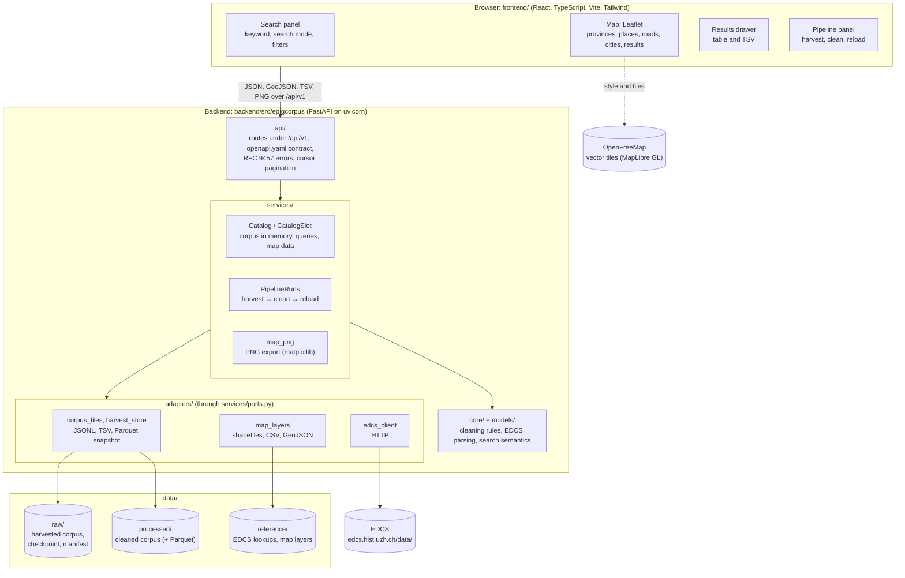
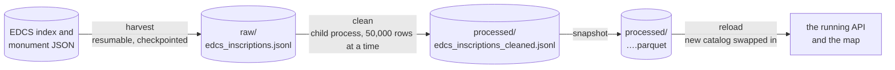

# EpigCorpus


EpigCorpus is a reproducible Latin epigraphy pipeline for extracting inscriptions from the Epigraphik-Datenbank Clauss / Slaby (EDCS), cleaning inscription text into research-ready variants, and exploring results on an interactive Roman Empire map.

The repository is designed as a practical, end-to-end workflow:
1. Scrape EDCS data incrementally with checkpoint resume.
2. Generate conservative and interpretive cleaned text.
3. Explore and export results through an HTTP API and the web map built on it.

## Run it

With Docker (nothing else to install):

```bash
docker compose up --build        # http://localhost:8000
```

Or locally, with [uv](https://docs.astral.sh/uv/) and Node 22:

```bash
cd frontend && npm ci && npm run build && cd ..          # the web UI, once
cd backend && uv sync
uv run uvicorn epigcorpus.api.server:app --port 8000     # http://127.0.0.1:8000
```

The server answers from the cleaned corpus committed in `data/`. The first
start converts it to a Parquet snapshot, which takes about a minute. After
that it starts in a few seconds.

To harvest from the EDCS, clean, and load the new corpus, use the
**Pipeline** panel in the web UI, or the API:

```bash
curl -X POST localhost:8000/api/v1/pipeline-runs -H 'content-type: application/json' -d '{}'
```

## Author

- Sanoj Doddapaneni

## Software Citation

Doddapaneni, S. (n.d.). EpigCorpus: A reproducible Latin epigraphy pipeline for extracting, cleaning, and exploring EDCS inscriptions [Computer software]. GitHub.

## Highlights

- Incremental scraping against the current EDCS API with append-only updates.
- One-row-per-inscription data model.
- Structured exports in JSONL and TSV.
- Two cleaning outputs for analysis workflows:
  - Conservative Cleaned Inscriptions
  - Interpretive Cleaned Inscriptions
- Interactive map in a light and a dark theme, on OpenFreeMap vector
  basemaps (Positron and Dark Matter designs, no API key), with their place
  names removed. When zoomed out, known places are grouped into a density
  grid; zoomed in, there is one solid circle per place, sized by its
  inscription count. Stacked bottom to top: basemap, Roman provinces with
  their names (the base, on by default), teal known places, roads, ochre
  cities, and terracotta search results on top.
- Search across raw and cleaned text, with filters for language, province,
  place, category and material.
- TSV download of the results and a publication-style 4K PNG map export
  (3,840 × 2,798) that follows the query's filters and the map's layers.
- An in-app data pipeline: harvest from the EDCS, clean, and reload the
  corpus into the running server.
- A versioned HTTP API (`/api/v1`, OpenAPI 3.1) for search, records, cleaned
  variants, places (also as GeoJSON), downloads, lookups and pipeline runs.

## Example PNG Export (term: viator)


## Architecture

One backend package serves a versioned HTTP API and the built web UI on one
origin. The browser draws the basemap straight from OpenFreeMap; everything
else comes from the API. Inside the backend, dependencies point one way:
routes call services, and services reach files and the network only through
the interfaces in `services/ports.py`, which the adapters implement.



A pipeline run, started from the Pipeline panel (`POST /api/v1/pipeline-runs`):



## Repository Layout

```text
EpigCorpus/
├── backend/               # the epigcorpus Python package (uv project)
│   ├── src/epigcorpus/
│   │   ├── config/        # paths (overridable by environment) and settings
│   │   ├── models/        # the inscription column schema
│   │   ├── core/          # pure rules: cleaning, EDCS parsing, search semantics
│   │   ├── adapters/      # EDCS HTTP client, corpus and harvest files, map layers
│   │   ├── services/      # use cases: harvest, clean, catalog, pipeline runs (+ ports.py)
│   │   └── api/           # FastAPI under /api/v1 and its contract, openapi.yaml
│   └── tests/
├── frontend/              # React + TypeScript + Vite + Tailwind + Leaflet
│   ├── src/api/           # typed client; schema.d.ts is generated from openapi.yaml
│   ├── src/features/      # search panel, map, results drawer, pipeline panel
│   └── e2e/               # Playwright tests against the running app
├── data/                  # raw/, processed/, reference/ (see data/README.md)
├── research/              # the abbreviation study: scripts/, reports/, results/
├── docs/                  # ADRs, API and data notes, refactor records
├── Dockerfile, docker-compose.yml
└── .github/workflows/ci.yml
```

Dependencies point one way. The web UI calls the API, and the API calls
services. Services reach adapters only through the interfaces in
`services/ports.py`; `backend/tests/test_layering.py` enforces this. See
`docs/adr/0001-layered-app-layout.md` and
`docs/adr/0005-backend-frontend-split.md`.

## Development

```bash
# backend
cd backend
uv run pytest                        # unit, contract and layering tests
uv run ruff check src tests

# frontend: Vite on :5173, forwarding /api to the backend on :8000
cd frontend
npm run dev
npm test                             # vitest
npm run typecheck
npm run gen:api                      # regenerate API types after editing openapi.yaml
npm run e2e                          # Playwright, against a server on :8000 (E2E_BASE_URL)
```

Research scripts import the package:
`uv run --project backend python research/scripts/<name>.py`.

## Data Products

Under `data/` (paths are defined in `backend/src/epigcorpus/config/paths.py`):

- `raw/edcs_inscriptions.jsonl[.gz]`, `raw/edcs_inscriptions.tsv[.gz]`: the
  harvested corpus, one inscription per row.
- `raw/harvest/`: the harvest's checkpoint, manifest and failure list.
- `reference/edcs_lookup.json`: the EDCS code tables; `reference/map_layers/`:
  the vendored map layers.
- `processed/edcs_inscriptions_cleaned.jsonl[.gz]`: the cleaned corpus, which
  the API serves. Its Parquet snapshot
  (`processed/edcs_inscriptions_cleaned.parquet`) is rebuilt automatically
  and not committed.

See data/README.md for schemas.

## Pipeline Details

A pipeline run (`POST /api/v1/pipeline-runs`) has three stages:

1. **Harvest**: `services/scrape.py`, over `adapters/edcs_client.py`.
   It is incremental and resumable from a checkpoint. A cancelled run resumes
   where it stopped.
2. **Clean**: `core/cleaning.py` holds the rules and `services/cleaning.py`
   applies them. Each inscription gets a conservative and an interpretive
   variant.
3. **Reload**: the running server loads the new cleaned corpus and swaps it
   in without a restart.

The web UI is a client of the API:

- Search modes: Raw inscriptions, Interpretive Cleaned Inscriptions,
  Conservative Cleaned Inscriptions.
- Filters for language, province, place, category and material, combinable
  with the keyword.
- A Leaflet map with a layers menu, tooltips and result popups; the legend
  starts collapsed.
- A results drawer, collapsed to one bar until opened, with the table a page
  at a time and the TSV download.
- A 4K PNG export of the map, following the query and the layers switched on.
- Light and dark themes (or the system's), remembered per browser.
- The search is kept in the address bar, so it can be shared as a link.

## Data and Software References

### Primary Data Sources

1. Clauss, M., Kolb, A., Slaby, W. A., and Woitas, B. Epigraphik-Datenbank Clauss / Slaby (EDCS). Universitat Zurich and Katholische Universitat Eichstatt-Ingolstadt. https://edcs.hist.uzh.ch/ (accessed 2026-06-03).
2. EDCS API endpoint used by this scraper: https://edcs.hist.uzh.ch/api/query (accessed 2026-06-03).
3. Hanson, J. W. (2016). Cities Database (OXREP Databases), Version 1.0. Oxford Roman Economy Project. DOI: https://doi.org/10.5287/bodleian:eqapevAn8. URL: http://oxrep.classics.ox.ac.uk/databases/cities/.
4. EDCS static data endpoints, which the harvest reads since EDCS withdrew `/api/query` (see docs/EDCS_API.md); release `20260807-142626`, harvested 2026-08-19:
   - Corpus index: https://edcs.hist.uzh.ch/data/indexes/searchable.json
   - Code tables (materials, provinces, categories): https://edcs.hist.uzh.ch/data/indexes/lookups.json
   - Places with coordinates: https://edcs.hist.uzh.ch/data/indexes/places.json
   - Languages: https://edcs.hist.uzh.ch/data/indexes/languages.json
   - Bibliographic sources: https://edcs.hist.uzh.ch/data/indexes/sources.json
   - One record per monument: `https://edcs.hist.uzh.ch/data/monument/{shard}/{id8}.json`
   - Monument photographs, linked from the records (not downloaded): `https://edcs.hist.uzh.ch/bilder/{prefix}/{filename}`

### Historical GIS Layers

1. Ancient World Mapping Center (AWMC). Geodata repository. https://github.com/AWMC/geodata (accessed 2026-06-03).
2. Province boundary layer used: roman_empire_ad_117.
3. Road network layer used: ba_roads.

### Basemaps and Land Outlines

1. OpenFreeMap. Free vector map tiles, no API key. https://openfreemap.org/. Styles used by the web map: Positron (light theme), https://tiles.openfreemap.org/styles/positron, and Dark (dark theme), https://tiles.openfreemap.org/styles/dark.
2. OpenMapTiles. Vector tile schema behind the OpenFreeMap styles. https://openmaptiles.org/.
3. OpenStreetMap contributors. Map data under the Open Database License (ODbL). https://www.openstreetmap.org/copyright.
4. Kelso, N. V., and Patterson, T. Natural Earth, 1:50m land (public domain). Made with Natural Earth, https://www.naturalearthdata.com/. Vendored as `data/reference/map_layers/natural_earth_land_50m.geojson`, served at `/api/v1/map/layers/land`.
5. Bostock, M. world-atlas (Version 2.0.2) [Computer software]. ISC licence. https://github.com/topojson/world-atlas. The TopoJSON redistribution of Natural Earth from which the land outlines were converted.

The web map credits OpenFreeMap, OpenMapTiles and OpenStreetMap in its
attribution line, as their terms require.

### Upstream Method Reference

1. Ballsun-Stanton, B., Hermankova, P., and Laurence, R. (2024). LatEpig (Version 2.0) [Computer software]. GitHub. https://github.com/mqAncientHistory/Lat-Epig/. DOI: https://doi.org/10.5281/zenodo.12036539.

### Language Model (research only)

1. Riemenschneider, F., and Frank, A. (2023). Exploring Large Language Models for Classical Philology. In Proceedings of the 61st Annual Meeting of the Association for Computational Linguistics (Volume 1: Long Papers), pp. 15181–15199. Toronto. DOI: https://doi.org/10.18653/v1/2023.acl-long.846. The phase 5 abbreviation model (`research/scripts/phase5_m3.py`) fine-tunes their Latin model LaBerta, https://huggingface.co/bowphs/LaBerta (Apache-2.0); see `research/reports/decisions.md`, D-0037.

### Typeface

1. Andersson, R. Inter (variable) [Typeface]. SIL Open Font License 1.1. https://rsms.me/inter/. Bundled through `@fontsource-variable/inter`.

### Software Stack

1. Python. https://www.python.org/
2. pandas. https://pandas.pydata.org/
3. GeoPandas. https://geopandas.org/
4. Matplotlib. https://matplotlib.org/
5. Leaflet. https://leafletjs.com/
6. Requests. https://requests.readthedocs.io/
7. Streamlit. https://streamlit.io/
8. FastAPI. https://fastapi.tiangolo.com/
9. React. https://react.dev/
10. Vite. https://vite.dev/
11. Tailwind CSS. https://tailwindcss.com/
12. uvicorn (ASGI server). https://www.uvicorn.org/
13. Pydantic. https://docs.pydantic.dev/
14. Apache Arrow / PyArrow (the Parquet snapshot). https://arrow.apache.org/
15. Shapely. https://shapely.readthedocs.io/
16. pyproj / PROJ. https://pyproj4.github.io/pyproj/
17. pyogrio / GDAL (shapefile reading). https://pyogrio.readthedocs.io/
18. NumPy. https://numpy.org/
19. MapLibre GL JS (vector basemap rendering). https://maplibre.org/
20. maplibre-gl-leaflet (MapLibre inside Leaflet). https://github.com/maplibre/maplibre-gl-leaflet
21. TypeScript. https://www.typescriptlang.org/
22. openapi-typescript (API types from the contract). https://openapi-ts.dev/
23. Lucide (icons). https://lucide.dev/
24. Playwright (end-to-end tests). https://playwright.dev/
25. Vitest (unit tests). https://vitest.dev/
26. pytest. https://pytest.org/
27. Ruff (linting). https://docs.astral.sh/ruff/
28. uv (Python packaging). https://docs.astral.sh/uv/
29. Docker and Docker Compose. https://www.docker.com/
30. Research only (the `ml` dependency group): PyTorch, https://pytorch.org/; Hugging Face Transformers, https://huggingface.co/docs/transformers; scikit-learn, https://scikit-learn.org/.

Streamlit (7) served the original map, which is on `main`; this version replaces it with the React UI.

## Reproducibility Notes

- Scraping is incremental and resumable.
- Cleaning is deterministic for a given input dataset.
- Map search and PNG export use the same cleaned source data.
- The cleaned corpus is written chunk by chunk and verified byte-identical to
  whole-frame cleaning (see CHANGELOG.md for the checksums).
- Map layers and the land outlines are vendored in `data/reference/map_layers`
  with their licences (see its README); only the basemap tiles are fetched at
  run time.
- Search mode naming is synchronized across UI, match summaries, and exports.

## License

MIT License. See LICENSE.
