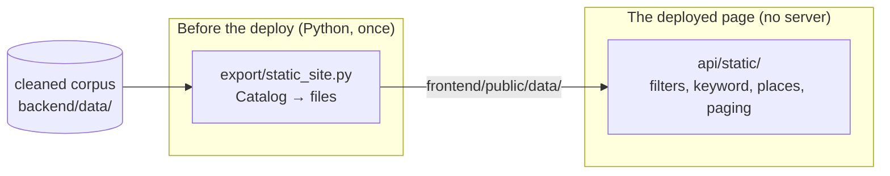

# The static site (GitHub Pages)

The app has two ways to run:

| | who answers the queries | what it can do |
|---|---|---|
| **API-served** (the default) | FastAPI, in `backend/` | everything, including the pipeline |
| **Static** (`VITE_DATA_MODE=static`) | the browser | search, filters, map, results, TSV, PNG |

The static build exists because GitHub Pages serves files and runs nothing:
no Python, no uvicorn, no scraping. So the corpus ships with the page, and
the query the server used to answer is answered in the browser.



The exporter reads the same `Catalog` the API answers from, so the precomputed
files cannot drift from what the server would have said.

## What the page carries instead of a server

`python -m epigcorpus.export.static_site` writes one set of fixed-name files
into `frontend/public/data/`, which the Vite build copies into `dist/data/`.
About 43 MB in total, fetched lazily:

| file | size | when the page fetches it |
|---|---|---|
| `corpus.bin.gz` | 6.9 MB | on load: the search frame, 568,560 rows, dictionary-encoded |
| `facets.json` | 0.5 MB | on load: the filter values present in the corpus |
| `known_places.geojson` | 3.0 MB | on load: the teal places |
| map layers (`provinces`, `province-labels`, `roads`, `cities`) | 1.1 MB | on load: the map's own layers |
| `openapi.yaml` | 0.1 MB | when the API reference is opened |
| `text-raw.bin.gz` | 13.5 MB | first search in Raw |
| `text-conservative.bin.gz` | 8.4 MB | first search in Conservative |
| `text-interpretive.bin.gz` | 9.2 MB | first search in Interpretive |

Only one text blob is fetched, and only when a keyword search needs it: a
filter-only browse, which is most of what the map does, never loads one. The
blobs are gzipped and streamed through the browser's own decompressor.

`manifest.json` (0.6 KB) ties them together: the corpus fingerprint, the row
count and each blob's byte length. The page fetches with `no-cache`, checks
the fingerprint and the lengths, and inlines its own reading of the binary
format (`frontend/src/api/static/container.ts`), refusing anything it does not
recognise. A redeploy can never leave the page holding half of one build and
half of another.

## Building it locally

```bash
cd backend
uv sync
uv run python -m epigcorpus.export.static_site --out ../frontend/public/data

cd ../frontend
VITE_DATA_MODE=static VITE_BASE=/EpigCorpus/ npm ci
VITE_DATA_MODE=static VITE_BASE=/EpigCorpus/ npm run build
```

`VITE_BASE` is the path the site is served from: `/EpigCorpus/` on Pages,
`/` for the API-served build (which is what `npm run build` does on its own).
The export takes about a minute on the full corpus; the build itself is fast.

To look at the result with Python alone, serve a directory that has the build
at that path:

```bash
mkdir -p /tmp/epigpages && ln -sfn "$PWD/frontend/dist" /tmp/epigpages/EpigCorpus
python3 -m http.server 8123 --directory /tmp/epigpages   # http://localhost:8123/EpigCorpus/
```

## Deploying to GitHub Pages

`.github/workflows/pages.yml` does the two steps above on every push to `main`
and publishes `frontend/dist`. No secrets, no build service.

One click is still manual: **Settings → Pages → Source: “GitHub Actions”**.
The job cannot do it for you — `GITHUB_TOKEN` is not allowed to create a Pages
site, so `configure-pages` with `enablement: true` fails with “Resource not
accessible by integration”. Once the site exists, every run after it works.

Pushes to a branch that is listed in the workflow's `branches:` also deploy,
which is how the change that added this could be seen on the real URL before
being merged into `main`.

The workflow rebuilds the corpus files from the cleaned corpus committed in
`data/` on every run. So the deployed site is exactly the corpus in the
repository, and re-harvesting means running the pipeline on a machine with
Python, committing the new cleaned corpus, and pushing.

## What the static build does not have

- **The pipeline.** There is no server to harvest or clean, so the panel and
  every `/pipeline-runs` call are absent. A clone of the repo still has them:
  `npm run dev` with the backend running is the full app.
- **The server's 4K PNG.** The API renders that with matplotlib; the static
  build captures the map's canvas instead, at the size it is displayed. Layers
  are composited by hand, because the basemap draws in its own canvas element.
- **The full-width TSV export.** The API's export is every column of the
  cleaned corpus; the static download carries the columns the page holds
  (record, province, place, coordinates, dating, language, material,
  categories, and the searched text variant), and only the searched variant is
  filled — the other two are not loaded, so they are left empty.
- **`/inscriptions/{record_id}/variants`** and the other routes nothing in the
  UI calls; the engine answers the paths the UI asks for and says so when a
  path needs the API.

Everything else — the map, the layers, the theme, the filters, the phrasing of
a query's title, the popup examples, paging, the shared URLs — is the same
code, so a shared link opens the same view on either build.
